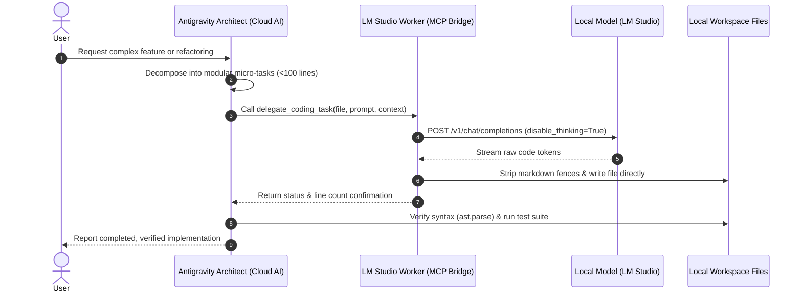

# LM Studio Worker for Antigravity CLI (`agy`)

[](https://www.python.org/downloads/)
[](LICENSE)
[](#)
[](#)

A high-performance Model Context Protocol (MCP) server that connects **Google Antigravity CLI (`agy`)** to **LM Studio**. This integration establishes an **Architect vs. Worker** workflow where cloud-grade reasoning models delegate repetitive code writing, module generation, and refactoring to local, offline LLMs without consuming cloud API quotas.

---

## Architecture Overview



---

## Key Features

- **Zero Cloud Quota Burn**: Heavy module implementations and boilerplate code are drafted entirely on your local GPU/CPU.
- **Direct File Streaming**: Code is written incrementally to the destination path on disk with automatic markdown fence (` ``` `) stripping.
- **Thinking Token Suppression**: Automatically passes `chat_template_kwargs={"enable_thinking": False}` to prevent local reasoning models (such as Qwen 2.5/3.x) from looping indefinitely.
- **Automatic Routing**: Directs tasks to `local-model`, which automatically resolves to whichever model is loaded in your active LM Studio session.
- **Context Injection**: Allows passing specific read-only reference files (`context_files`) so local models have upstream interfaces without exceeding their context window.

---

## Repository Structure

```
lmstudio-worker-agy/
├── server.py              # Core FastMCP server implementation
├── SKILL.md               # Antigravity skill specification & delegation rules
├── install.ps1            # One-click Windows installer & MCP auto-configurator
├── requirements.txt       # Python dependencies (mcp, openai, httpx)
├── LICENSE                # MIT License
├── README.md              # Documentation & reference manual
└── tests/
    └── test_worker.py     # Connectivity & delegation unit tests
```

---

## Quick Start

### 1. Prerequisites
- **LM Studio** installed and running with a coding model loaded (e.g., `qwen/qwen3.8-27b`, `qwen2.5-coder-7b/14b/32b`, or similar).
- **Start the Local Server**: In LM Studio, navigate to the **Developer** tab and ensure the local server is started on `http://localhost:1234`.
- **Python 3.10+** installed and available on `PATH`.
- **Antigravity CLI (`agy`)** or Antigravity IDE.

### 2. Automatic Installation (PowerShell)
Open PowerShell inside the repository directory and run:

```powershell
powershell -ExecutionPolicy Bypass -File .\install.ps1
```

The script will:
1. Install required packages (`mcp`, `openai`, `httpx`).
2. Register `lmstudio-worker` inside your global `mcp_config.json`.
3. Copy `SKILL.md` into your Antigravity skills repository.
4. Verify connectivity to your local LM Studio server.

### 3. Manual Configuration
If you prefer manual registration, add the following entry to your `mcp_config.json` (`~/.gemini/antigravity-cli/mcp_config.json` or `~/.gemini/config/mcp_config.json`):

```json
{
  "mcpServers": {
    "lmstudio-worker": {
      "command": "python",
      "args": [
        "C:\\Path\\To\\lmstudio-worker-agy\\server.py"
      ],
      "disabled": false
    }
  }
}
```

---

## MCP Tools Reference

### `delegate_coding_task`
Delegates a scoped file creation or modification task to the active local model.

| Argument | Type | Description |
| :--- | :--- | :--- |
| `file_path` | `string` | Absolute or relative destination path of the file to create or overwrite. |
| `task_instructions` | `string` | Detailed requirements and signatures for the code to implement. |
| `context_files` | `list[string]` | *(Optional)* Paths to reference files that provide interfaces, types, or dependencies. |
| `model_override` | `string` | *(Optional)* Target a specific model identifier instead of the default active model. |

**Example Invocation:**
```python
delegate_coding_task(
    file_path="src/utils/geometry.py",
    task_instructions="Implement a Point and Polygon class with ray-casting point-in-polygon containment check.",
    context_files=["src/types.py"]
)
```

### `get_worker_status`
Queries the local LM Studio instance and returns:
- Connection state (`online` / `offline`)
- Base API URL
- Currently loaded model list
- Active model fallback identifier

### `list_local_models`
Returns a list of strings representing all model keys currently available in LM Studio.

---

## Best Practices for Local Delegation

1. **Keep Delegated Tasks Scoped**:
   Local models perform best when generating self-contained modules under 80–120 lines. Avoid asking for entire complex multi-file projects in a single prompt.
2. **Empty Context When Not Needed**:
   Passing `context_files=[]` eliminates model prefill delay, allowing local inference to start instantly.
3. **Programmatic Verification**:
   Have your primary agent verify generated files immediately after generation using automated tests:
   ```powershell
   python -c "import ast; ast.parse(open('generated_file.py').read()); print('Syntax Valid')"
   ```
4. **Environment Variables**:
   Customize connections using environment variables:
   - `LMSTUDIO_BASE_URL`: Defaults to `http://localhost:1234/v1`
   - `LMSTUDIO_API_KEY`: Defaults to `lm-studio`
   - `LMSTUDIO_MODEL`: Defaults to `local-model`

---

## Contributing & Attribution

- **Creator & Maintainer**: SidiElvalli
- **AI Collaborator**: Gemini (Google DeepMind)
- **License**: [MIT License](LICENSE)
